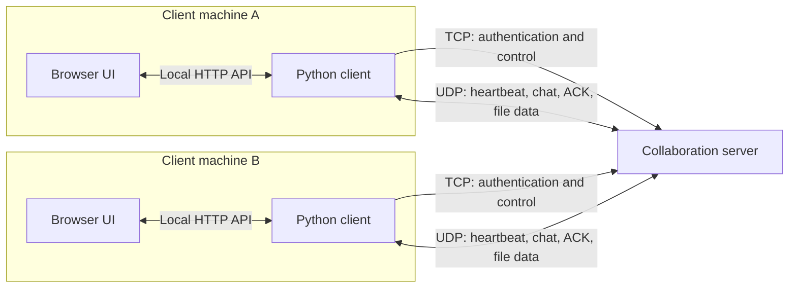
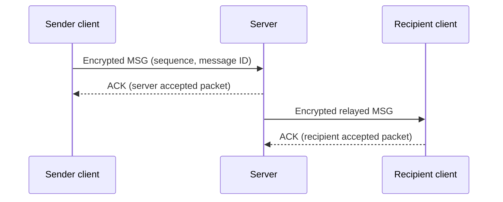
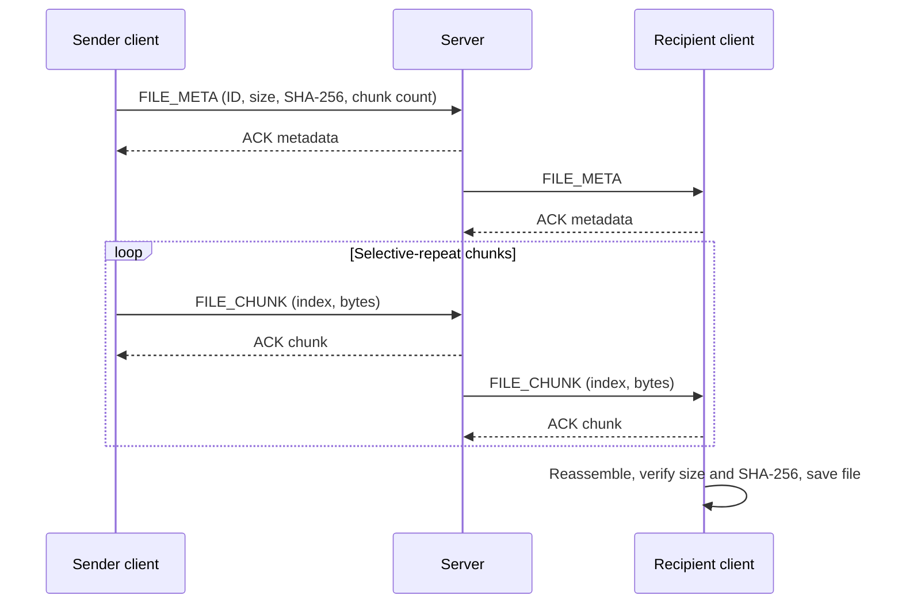

# Technical Explanation Report

## Distributed and Streaming-Based Client-Server Collaboration Application

**Course:** Network Application Development  
**Project type:** Individual / Pair Project  
**Implementation language:** Python 3.10+  

## 1. Project overview

This project is a self-hosted collaboration demo for authenticated users on a
local network. It supports user discovery, broadcast and private chat, and
reliable file delivery. The implementation uses Python's raw `socket` API for
network communication. A small browser UI is served locally by the Python
standard library; it does not use a web framework or WebSockets.

TCP is used for login and control, while UDP carries heartbeats, user lists,
messages, acknowledgements, and file data. Reliability for UDP application
traffic is implemented at the application layer with sequence numbers,
selective acknowledgements, retransmission, and bounded sliding windows.

## 2. System architecture



The browser communicates with its local client process through HTTP endpoints.
The client and server use separate TCP and UDP sockets. The server maintains
authenticated user state, maps each user to their TCP connection and UDP
endpoint, and relays messages and file packets to their intended recipients.
The network protocol and cryptographic encoding are shared by the client and
server.

### Main responsibilities

| Component | Responsibility |
| --- | --- |
| Browser UI | Display messages, online users, and file-transfer status; submit user actions to the local client. |
| Client | Authenticate, send heartbeats and application packets, process incoming packets, and expose local UI endpoints. |
| Server | Authenticate clients, track active users, process UDP packets, and reliably relay traffic to recipients. |
| Application protocol | Encode packet headers and payloads, validate received packets, and provide message/file transfer identifiers. |

## 3. Protocol specification

### 3.1 TCP control channel

The server listens on TCP port `9000`. Control messages are UTF-8 JSON objects,
one per line, with an 8 KiB line limit.

1. The server sends `HELLO`.
2. The client responds with `AUTH`, username, UDP port, and an encrypted
   password token.
3. The server responds with `AUTH_OK` or `AUTH_FAIL`.
4. An authenticated client periodically sends `PING`; the server replies with
   `PONG`.

The server rejects invalid credentials and duplicate active usernames. TCP
connection cleanup removes a user whose control connection closes.

### 3.2 UDP application packet

The server listens on UDP port `9001`. A datagram consists of a fixed
33-byte, network-byte-order header followed by an optional encrypted payload.

| Field | Size |
| --- | ---: |
| Magic (`NP`) | 2 bytes |
| Protocol version | 1 byte |
| Packet type | 1 byte |
| Flags | 1 byte |
| Sequence number | 4 bytes |
| Message ID | 16 bytes |
| Chunk index | 2 bytes |
| Total chunks | 2 bytes |
| Encrypted payload length | 4 bytes |

Supported packet types are `HEARTBEAT`, `MSG`, `FILE_META`, `FILE_CHUNK`,
`ACK`, and `USER_LIST`. The `FLAG_END` flag indicates a completed message or
the final file chunk. The decoder validates the magic, version, type, flags,
chunk coordinates, declared payload length, and encryption status before
passing a packet to application logic.

### 3.3 Chat and reliability

A chat payload is JSON containing the destination (`*` for broadcast or a
username for private chat) and message text. The server verifies that the UDP
source endpoint belongs to an authenticated user, validates the request, and
queues a copy for each recipient.

Each packet is identified by its message ID and sequence number. The receiver
acknowledges packets individually. The sender and each server-to-recipient
relay use bounded in-flight windows and retry packets whose acknowledgements
have not arrived. A finite retry limit prevents a permanently unreachable
peer from blocking a stream indefinitely. Each recipient/stream has a
separate relay worker, so packet loss on one stream does not hold up unrelated
streams. The client window grows up to eight packets using a bounded
CUBIC-style mechanism and is reduced when loss is detected.



An ACK from the server means the server accepted the packet for relay; it does
not mean that the recipient has read the message.

### 3.4 Reliable file transfer

The sender first sends encrypted `FILE_META` containing a file ID, recipient,
basename, file size, SHA-256 digest, and expected chunk count. It waits for the
metadata ACK before sending file data. Files are split into 900-byte chunks.
Each chunk includes the file ID, sequence number, chunk index, and total chunk
count. The receiver stores chunks by index, tolerates duplicates and
out-of-order arrival, and reassembles the file when all chunks have arrived.

The server validates each chunk against the transfer metadata and relays it
using a separate selective-repeat window for the file/recipient stream. The
receiver checks the final size and SHA-256 digest before saving to
`downloads/`. Incomplete incoming transfers expire after 15 seconds. The
maximum file size is 50 MiB, and an encoded UDP datagram is limited to 1,400
bytes to avoid fragmentation on common 1,500-byte LAN MTUs.



## 4. Security

Non-empty UDP payloads and the TCP authentication password token are encrypted
with Fernet using the shared `COLLAB_FERNET_KEY`. Fernet provides payload
confidentiality and authentication. The UDP header, IP addresses, packet
timing, and packet sizes remain observable.

The shared key must be configured separately in each process and is not stored
in the source repository. This is a teaching implementation, not a
production-ready secure messenger: demo credentials in `users.json` are
plaintext, the key is manually provisioned and shared, and the system does
not provide key exchange, per-user keys, TLS certificate validation, or key
rotation. Demo accounts should not be reused for real services.

## 5. Challenges and solutions

### Reliable delivery over UDP

UDP does not guarantee delivery, ordering, or duplicate suppression. Sending a
large file as a single datagram would also exceed practical network packet
sizes and risk fragmentation. The application addresses these constraints by
splitting files into small indexed chunks and assigning sequence numbers and
message IDs. Receivers acknowledge individual packets; senders retransmit
unacknowledged packets within a bounded window and stop after a finite retry
limit. Reassembly is indexed rather than arrival-order-dependent, so reordered
chunks can still produce the original file. A final SHA-256 comparison detects
missing or corrupted content before it is saved.

### Avoiding head-of-line blocking

A single global queue or relay loop could cause one slow recipient to delay
other users and transfers. The server therefore maintains independent relay
workers and acknowledgement state for each recipient/stream. The sender also
slides its window forward as ACKs arrive instead of waiting for every packet
in a batch. This keeps progress independent between unrelated messages and
transfers while retaining a bounded amount of in-flight data.

### Keeping datagrams within network limits

Encrypted payloads are larger than their original content, so choosing a
chunk size based only on the raw data can result in oversized UDP datagrams.
Chunks are limited to 900 bytes, and packet encoding enforces a 1,400-byte
datagram cap including the header and encryption overhead. The protocol also
rejects malformed lengths, invalid chunk coordinates, unsupported flags, and
unencrypted non-empty payloads. These checks make packet boundaries and
validation explicit instead of trusting input received from the network.

### Detecting incomplete or invalid transfers

Lost metadata or chunks can leave a receive operation incomplete. The client
tracks incoming transfer activity and expires transfers that have been idle
for 15 seconds. Duplicate metadata does not discard already received chunks.
Before writing a completed file, the client verifies the expected length and
digest. The UI distinguishes server acceptance from receiver completion so a
sender does not mistake an ACK from the server for proof that the recipient
saved the file.

### Clarifying transport requirements

The assignment describes TCP for reliable transfer in its technology
overview, while the file-transfer rubric explicitly asks for chunking and
reassembly over UDP. This implementation follows the rubric's UDP file
transfer requirement and implements reliability above UDP; TCP remains the
login/control channel. This design choice should be confirmed with the
instructor if the technology overview is intended to require file content
over TCP.

## 6. Testing and demonstration

The project includes automated tests for packet encoding/decoding, encrypted
payload tampering, packet-size limits, out-of-order file reassembly, duplicate
metadata, transfer timeouts, server routing, duplicate-message suppression,
chunk validation, congestion-window behavior, and sliding-window progress.
Run them from the project directory with:

```powershell
python -m pytest -q
```

For a network demonstration, start one server and at least two clients, using a
different UI port for each client on the same machine. Verify login, the live
user list, broadcast and private messages, and a file transfer. For a LAN
demonstration, allow inbound TCP `9000` and UDP `9001` through the host
firewall, configure the same shared encryption key on each machine, and
connect clients to the server's LAN address. Automated tests do not replace
this manual multi-client/firewall check.

## 7. Running the application

Install the dependencies from `requirements.txt`, configure the same
`COLLAB_FERNET_KEY` in the server and client environments, and start:

```powershell
python server.py
```

In separate terminals, start clients with distinct UI ports:

```powershell
python client.py --username alice --password alice123 --ui-port 8001
python client.py --username bob --password bob123 --ui-port 8002
```

Open the local URLs printed by each client. For full installation details,
demo account information, and LAN setup, see `README.md`.
