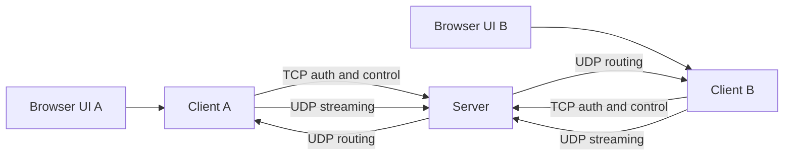
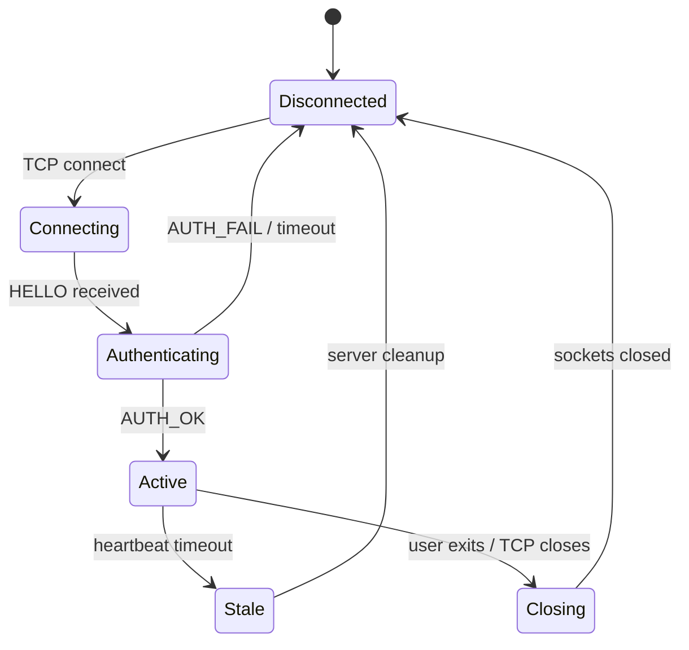
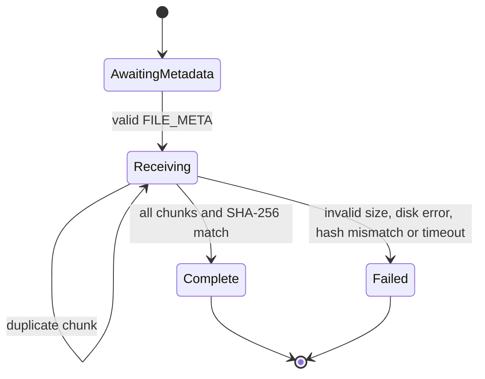

# Architecture

The application separates the browser UI, client network logic, server state, protocol encoding and cryptography.

The browser communicates only with its local client process. Client to server networking uses raw TCP and UDP sockets.

## Connection state

## File receive state

Per-recipient/per-stream relay workers and selective-repeat windows keep loss recovery independent between separate chats and file transfers. The server targets the assignment's 10-20 concurrent-client scale; larger deployments would need bounded queues, admission limits and persistent user/storage services.
