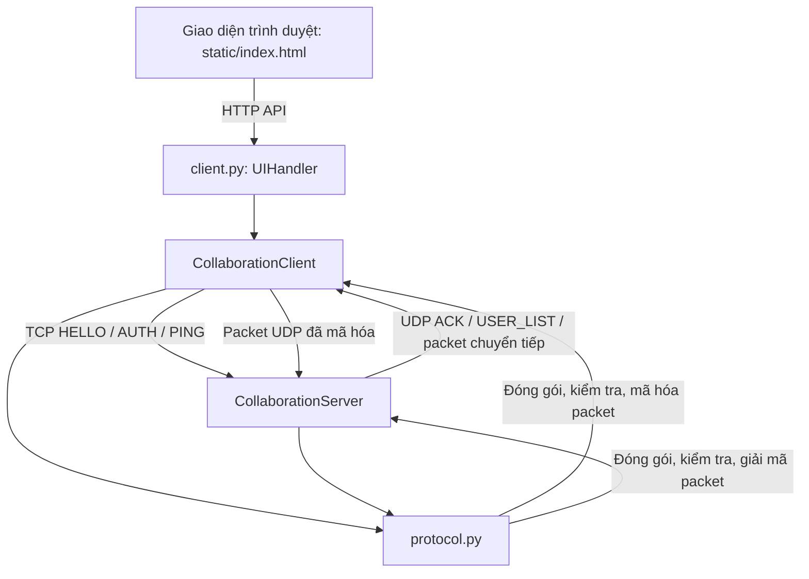
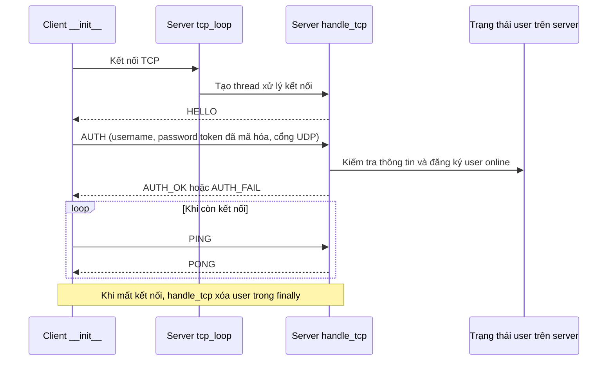
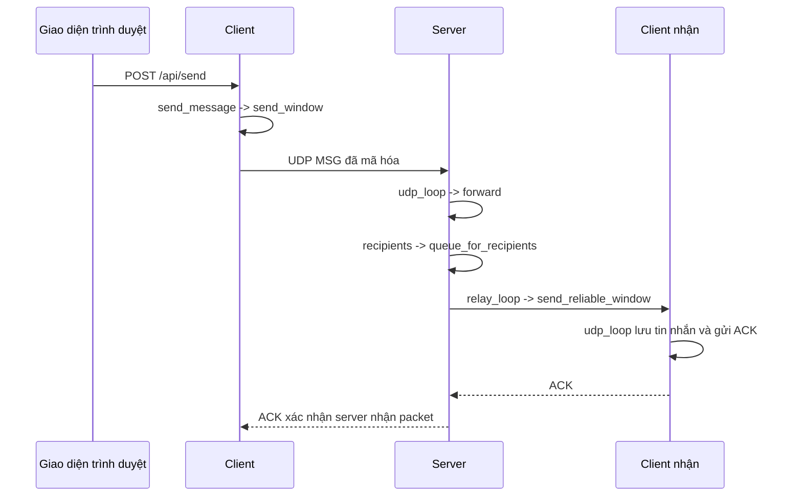
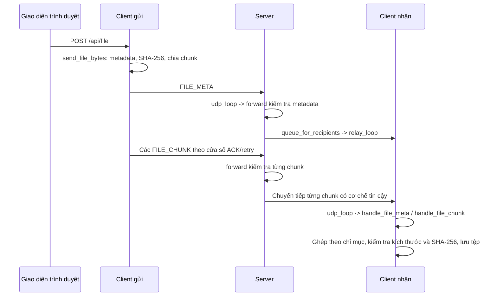

# Sơ đồ luồng và danh sách hàm: Protocol, Client, Server

Tài liệu này mô tả các hàm trong `protocol.py`, `client.py`, `server.py` và
cách chúng phối hợp trong quá trình đăng nhập, nhắn tin, truyền tệp và thoát
ứng dụng.

## Sơ đồ luồng tổng quan

`protocol.py` được dùng chung ở client và server. TCP phục vụ xác thực và điều
khiển; UDP truyền heartbeat, tin nhắn, ACK, danh sách người dùng và dữ liệu tệp.

## Sơ đồ luồng gọi hàm

### Đăng nhập, quản lý phiên và ngắt kết nối

`cleanup_loop()` của server cũng loại các user không gửi UDP heartbeat trong
thời gian quy định. `broadcast_user_list()` thông báo danh sách online mới cho
các client đang hoạt động.

### Gửi, định tuyến và nhận tin nhắn

`target == "*"` chọn tất cả user đang online ngoại trừ người gửi; username cụ
thể chọn một người nhận. Mỗi người nhận/luồng có hàng đợi và worker relay riêng.

### Gửi và ghép lại tệp

## Hàm và kiểu dữ liệu trong `protocol.py`

| Hàm/kiểu | Nhiệm vụ |
| --- | --- |
| `Packet` | Dataclass biểu diễn packet gồm loại, số thứ tự, UUID, chỉ mục/tổng số chunk, cờ và payload. |
| `encode_packet(packet, encrypt=True)` | Mã hóa payload không rỗng, đóng gói header cố định và kiểm tra giới hạn kích thước datagram UDP. |
| `decode_packet(data)` | Kiểm tra header, loại, cờ, chỉ mục chunk và độ dài payload; giải mã payload rồi trả về `Packet`. |
| `json_bytes(obj)` | Tuần tự hóa giá trị Python thành JSON dạng bytes gọn để đặt vào payload. |
| `json_obj(payload)` | Giải mã JSON bytes và yêu cầu kết quả là object/dictionary. |
| `new_id()` | Tạo UUID làm ID cho tin nhắn hoặc lần truyền tệp. |

Các hằng số của protocol định nghĩa magic value, phiên bản, loại packet, cờ,
bố cục header và Fernet cipher dùng chung.

## Danh sách hàm trong `client.py`

### `CollaborationClient`

| Hàm | Nhiệm vụ |
| --- | --- |
| `__init__(username, password, server_host)` | Khởi tạo trạng thái và socket; thực hiện HELLO/AUTH qua TCP; khởi chạy các thread nhận UDP, heartbeat và ping TCP. |
| `next_seq()` | Lấy số thứ tự packet tiếp theo của client, có khóa đồng bộ. |
| `send_json_line(obj)` | Gửi thông điệp điều khiển JSON kết thúc bằng newline qua TCP. |
| `recv_json_line()` | Đọc và kiểm tra một dòng JSON điều khiển có giới hạn độ dài từ TCP. |
| `ack(packet)` | Gửi UDP ACK cho packet nhận từ server. |
| `mark_ack(packet)` | Ghép ACK nhận được với packet client đang chờ và báo hiệu event tương ứng. |
| `update_congestion_window(loss)` | Tăng hoặc giảm giới hạn cửa sổ gửi của client dựa trên tình trạng truyền/mất packet. |
| `send_window(packets)` | Gửi packet theo sliding window, chờ ACK và thử gửi lại packet chưa được xác nhận. |
| `send_message(target, text)` | Kiểm tra nội dung, tạo packet `MSG`, gửi đi và lưu tin nhắn gửi trong trạng thái client. |
| `send_file_bytes(target, name, data)` | Tạo metadata và SHA-256, chia dữ liệu thành chunk, gửi theo cửa sổ và cập nhật trạng thái/tiến trình. |
| `handle_file_meta(packet, body)` | Kiểm tra metadata của tệp nhận và khởi tạo trạng thái nhận. |
| `handle_file_chunk(packet)` | Kiểm tra và lưu chunk; khi đủ thì ghép, xác minh và lưu tệp hoàn chỉnh. |
| `udp_loop()` | Nhận/giải mã packet từ server; xử lý ACK, danh sách user, tin nhắn và packet tệp; gửi ACK cho packet hợp lệ. |
| `heartbeat_loop()` | Định kỳ gửi UDP heartbeat và hết hạn các lần nhận tệp chưa hoàn tất. |
| `expire_incoming_transfers()` | Xóa trạng thái nhận tệp đã quá thời gian và cập nhật trạng thái truyền. |
| `tcp_ping_loop()` | Gửi TCP `PING`, đọc `PONG` và đánh dấu client mất kết nối nếu TCP điều khiển lỗi. |
| `state()` | Trả về bản sao an toàn của trạng thái kết nối, user, tin nhắn và truyền tệp để giao diện sử dụng. |

### `UIHandler`

| Hàm | Nhiệm vụ |
| --- | --- |
| `reply(code, data, ctype)` | Gửi phản hồi HTTP gồm mã trạng thái, loại nội dung và độ dài. |
| `read_json()` | Đọc request body HTTP có giới hạn kích thước và yêu cầu nội dung là JSON object. |
| `do_GET()` | Phục vụ `static/index.html` hoặc trả trạng thái hiện tại tại `/api/state`. |
| `do_POST()` | Xử lý `/api/send` và `/api/file`, kiểm tra dữ liệu request rồi gọi thao tác tương ứng của client. |
| `log_message(format, *args)` | Chuyển log của HTTP server chuẩn vào logger của ứng dụng. |

### Hàm khởi chạy module

| Hàm | Nhiệm vụ |
| --- | --- |
| `main()` | Đọc tham số dòng lệnh, tạo HTTP server cục bộ dạng đa luồng và client, chạy giao diện rồi đóng tài nguyên khi thoát. |

### JavaScript trong `static/index.html`

| Hàm | Nhiệm vụ |
| --- | --- |
| `api(path, options)` | Gọi HTTP API cục bộ và chuyển phản hồi lỗi thành lỗi JavaScript. |
| `refresh()` | Lấy trạng thái client rồi hiển thị danh sách user, lựa chọn người nhận, tin nhắn và tiến trình truyền tệp. |
| `showError(error)` | Hiển thị thông báo lỗi trên trang. |
| `escapeHtml(s)` | Escape chuỗi động trước khi chèn vào HTML được dựng. |
| `sendMessage()` | Gửi nội dung và người nhận đã chọn đến `/api/send`. |
| `sendFile()` | Đọc tệp đã chọn rồi gửi dữ liệu Base64 đến `/api/file`. |

## Danh sách hàm trong `server.py`

### `CollaborationServer`: khởi tạo, xác thực và trạng thái

| Hàm | Nhiệm vụ |
| --- | --- |
| `__init__()` | Khởi tạo trạng thái user/truyền tệp/ACK và bind socket TCP, UDP. |
| `next_seq()` | Lấy số thứ tự packet tiếp theo của server, có khóa đồng bộ. |
| `send_json_line(conn, obj)` | Gửi thông điệp điều khiển JSON kết thúc bằng newline qua kết nối TCP của client. |
| `recv_json_line(file)` | Đọc và kiểm tra một dòng JSON có giới hạn độ dài. |
| `handle_tcp(conn, addr)` | Thực hiện HELLO/AUTH, đăng ký user đã xác thực cùng kết nối TCP/IP/endpoint UDP, xử lý PING/PONG và xóa user khi ngắt kết nối. |
| `tcp_loop()` | Chấp nhận kết nối TCP và tạo thread riêng gọi `handle_tcp()` cho mỗi kết nối. |
| `username_for_udp(addr)` | Tìm username đã xác thực tương ứng với endpoint UDP. |

### ACK và chuyển tiếp tin cậy

| Hàm | Nhiệm vụ |
| --- | --- |
| `ack(addr, packet)` | Gửi ACK chứa message ID và số thứ tự của packet đã nhận. |
| `mark_ack(addr, packet)` | Ghép ACK từ người nhận với packet relay server đang chờ. |
| `send_reliable_window(items)` | Gửi một cửa sổ relay, chờ ACK, thử lại packet chưa được xác nhận và xóa trạng thái chờ. |
| `relay_loop(username, conn, stream_id, relay_queue)` | Lấy packet từ hàng đợi của một user/luồng và gửi qua `send_reliable_window()`. |

### Định tuyến, loại trùng và kiểm tra tệp

| Hàm | Nhiệm vụ |
| --- | --- |
| `recipients(target, sender)` | Chọn tất cả user online khác để broadcast hoặc một user online để gửi riêng. |
| `user_is_active(username)` | Kiểm tra username có đang được đăng ký hay không. |
| `queue_for_recipients(sender, target, packet)` | Tạo packet cho từng người nhận, đưa vào hàng đợi và khởi động relay worker khi cần. |
| `forward(sender, packet)` | Kiểm tra `MSG`, `FILE_META` hoặc `FILE_CHUNK`; loại packet gửi lại trùng lặp; định tuyến packet hợp lệ. |
| `_expire_transfers()` | Xóa bản ghi metadata/tin nhắn loại trùng đã hết hạn và trạng thái truyền tệp cũ. |

### Danh sách user, xử lý UDP, dọn dẹp và khởi động

| Hàm | Nhiệm vụ |
| --- | --- |
| `send_user_list(addr)` | Gửi danh sách username đang online đến một endpoint UDP. |
| `broadcast_user_list()` | Gửi danh sách user online đến tất cả client đã đăng ký. |
| `udp_loop()` | Nhận packet UDP, xử lý ACK/heartbeat/dữ liệu ứng dụng, xác minh endpoint người gửi và cập nhật thời điểm hoạt động. |
| `cleanup_loop()` | Xóa user có heartbeat quá thời hạn cấu hình và phát danh sách online mới. |
| `run()` | Khởi chạy các thread TCP, UDP và cleanup; chờ dừng rồi đóng socket khi nhấn Ctrl+C. |

## Các file liên quan

- [Phần cài đặt protocol](../protocol.py)
- [Client và HTTP server cục bộ](../client.py)
- [Phần cài đặt server](../server.py)
- [Giao diện trình duyệt](../static/index.html)
- [Chi tiết protocol](./protocol.md)
- [Kiến trúc và state diagram](./architecture.md)
