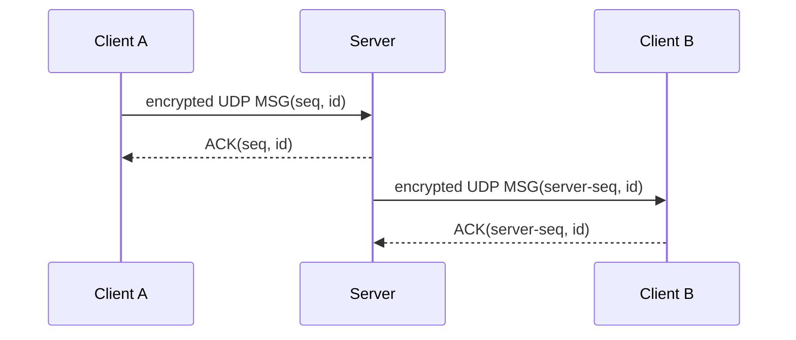
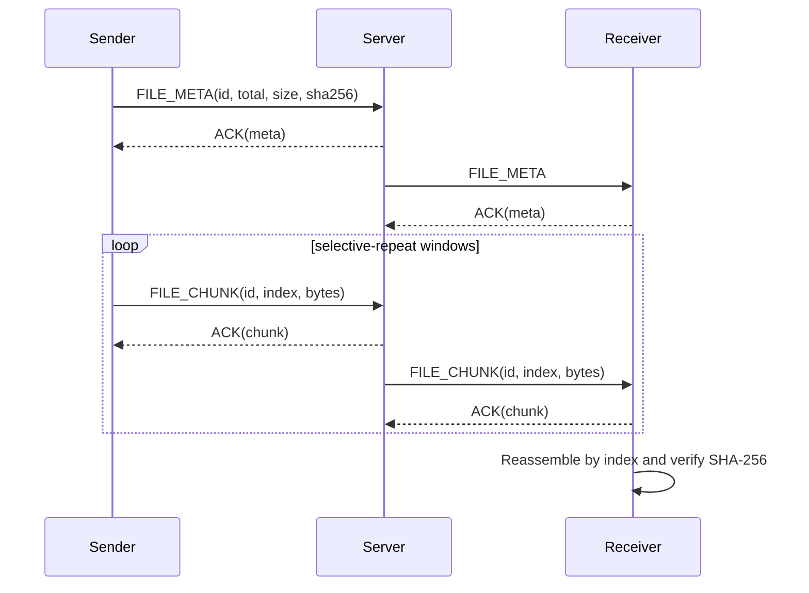

# Application protocol

All network traffic uses Python raw `socket` objects. TCP is used for login and control; UDP carries discovery, messages and file data. Non-empty UDP payloads and the authentication password token are encrypted with Fernet using the shared `COLLAB_FERNET_KEY`.

## TCP control channel

TCP port `9000` carries one UTF-8 JSON object per newline:

1. Server sends `{"type":"HELLO","server":"collab-demo"}`.
2. Client sends `AUTH`, username, UDP port and a Fernet-encrypted password token.
3. Server replies `AUTH_OK` or `AUTH_FAIL`.
4. Authenticated clients send `PING`; server replies `PONG`.

Control lines are limited to 8 KiB. The server rejects duplicate active usernames. The password is encrypted, but the username, message timing and control-channel metadata are not hidden.

## UDP header

UDP port `9001` carries a fixed 33-byte network-byte-order header followed by payload bytes:

| Field | Size |
| --- | ---: |
| Magic (`NP`) | 2 bytes |
| Version | 1 byte |
| Type | 1 byte |
| Flags | 1 byte |
| Sequence number | 4 bytes |
| Message ID | 16 bytes |
| Chunk index | 2 bytes |
| Total chunks | 2 bytes |
| Encrypted payload length | 4 bytes |

`FLAG_END` marks the final message packet or final file chunk; the receiver checks that it matches the packet type/index.

The decoder rejects invalid magic/version, unknown types, invalid chunk coordinates, unencrypted non-empty payloads and any datagram whose actual size does not match the declared length.

Types: `HEARTBEAT`, `MSG`, `FILE_META`, `FILE_CHUNK`, `ACK`, `USER_LIST`.

Payloads are Fernet tokens; encryption provides confidentiality and authentication for the payload. The header and UDP/IP metadata remain visible.

## Messages and acknowledgements

The client sends a `MSG` JSON object containing `to` (`*` or a username) and `text`. The server authenticates the UDP source endpoint against the TCP-authenticated user, validates the message and queues it independently for each recipient. Relayed packets receive a server sequence number and include the sender name in the encrypted JSON.

Each receiver ACKs a packet using its original message ID and sequence number. The sender and server keep bounded in-flight windows, retransmit only unacknowledged packets, and fail after a finite retry count. The client slides its window forward as individual ACKs arrive instead of waiting for a whole batch, and grows the window toward eight packets using a bounded CUBIC-style window; a timeout/retransmission reduces the window. Each recipient/message stream has its own relay worker so loss on an unrelated stream does not impose head-of-line blocking across all users.

The sender ACK confirms server acceptance; each server-to-recipient hop has its own retry/ACK cycle. This is not a guarantee that a recipient has read the message.

## File transfer

The sender creates a UUID for the file, sends encrypted JSON metadata, and waits for its ACK before sending any chunks. Metadata carries the recipient, basename, byte size, SHA-256 digest and expected chunk count. Each `FILE_CHUNK` uses the same UUID, raw chunk bytes as its payload, and `chunk` / `total` header fields. Chunks are 900 bytes before encryption; the application datagram is capped at 1,400 bytes to avoid IP fragmentation on common 1,500-byte LAN MTUs. A file is limited to 50 MiB.

The server remembers the authenticated sender and recipient for the file ID, validates each chunk's index and expected byte length, and forwards the raw chunk bytes. Each logical file/recipient stream is isolated and uses an eight-packet selective-repeat window. The receiver stores chunks by index, tolerates duplicates and reordering, checks total size and SHA-256, then writes the file under `downloads/` using a sanitized basename. Incomplete receives time out after 15 seconds. The sender's status confirms server acceptance; only the receiver's `done` status means the hash-verified file was saved.

An ACK from the server confirms that the packet was accepted for relay. Server relay retries independently to the recipient; the receiver reports transfer completion or a hash mismatch in its UI.
